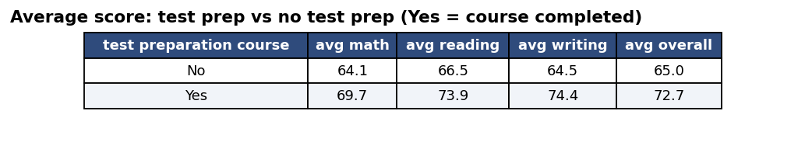
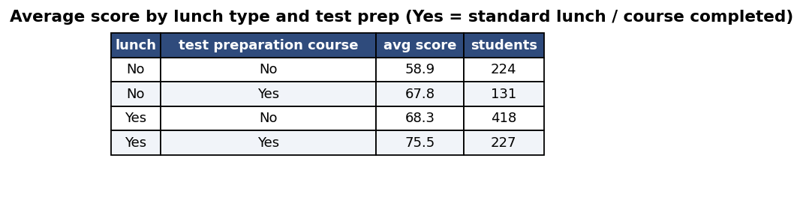
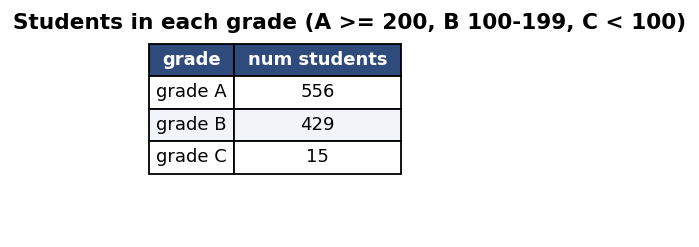
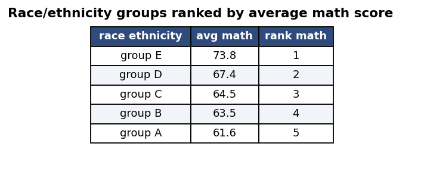
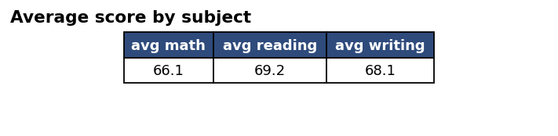
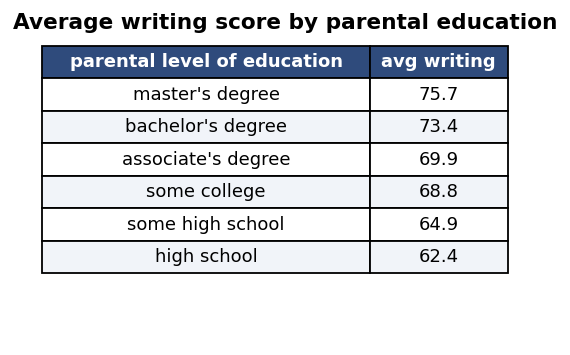

# Students Performance Analysis (SQL)

SQL analysis of 1,000 students' exam scores in PostgreSQL. Compares scores across gender, race/ethnicity, parental education, lunch type, and test-preparation status.

## Tech stack
- SQL, PostgreSQL

## Dataset
- File: `data/StudentsPerformance.csv` (1,000 rows)
- Columns: gender, race/ethnicity, parental level of education, lunch, test preparation course, math / reading / writing scores.
- Source: public Kaggle dataset "Students Performance in Exams" (add the exact link here).

## SQL concepts used
`GROUP BY`, aggregates (`AVG`, `MIN`, `MAX`, `STDDEV`, `COUNT`), `CASE` for grade bands, window function `RANK() OVER`, and cross-tab comparisons.

## Key findings
- **Test prep helps:** students who completed the course averaged **72.7** vs **65.0** without it (+7.7 points).
- **Lunch type matters:** standard-lunch students averaged **70.8** vs **62.2** for free/reduced lunch (+8.6 points).
- **Test prep narrows the gap:** free/reduced-lunch students with test prep (**67.8**) scored about the same as standard-lunch students without it (**68.3**).
- **Best vs worst group:** standard lunch + test prep scored **75.5**; free/reduced lunch + no test prep scored **58.9**.
- **Subjects:** math is the weakest (**66.1**), reading the strongest (**69.2**).
- **Grades:** 556 students in grade A, 429 in grade B, 15 in grade C.
- **Parental education:** writing scores rise from **62.4** (high school) to **75.7** (master's degree).

These are averages and show association, not proof of cause.

## Output screenshots
**Test prep vs no test prep**


**Lunch type and test prep**


**Grade bands**


**Math rank by race/ethnicity**


**Subject averages**


**Parental education**


## Project structure
```
students-performance-sql/
├── data/StudentsPerformance.csv
├── sql/
│   ├── 01_setup.sql        # create tables and load the CSV
│   └── 02_analysis.sql     # all analysis queries
├── images/
└── README.md
```

## How to run
```bash
git clone https://github.com/noopurrr/students-performance-sql-practice-analysis.git
cd students-performance-sql-practice-analysis
createdb students
psql -d students -f sql/01_setup.sql
psql -d students -f sql/02_analysis.sql
```
Run the commands from the project root folder so the CSV path works.

## Notes
- `lunch = TRUE` means standard lunch; `FALSE` means free/reduced lunch (used as a proxy for lower income).
- `test_preparation_course = TRUE` means the course was completed.
- Grade bands use total score out of 300: A is 200 or more, B is 100-199, C is below 100.
